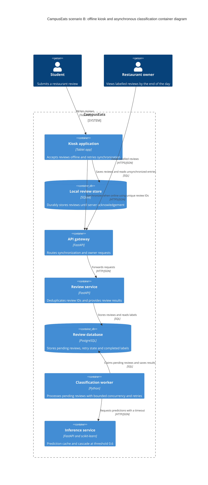

# Task 4: Deployment topologies and trade-offs

**Name / ชื่อ:** Chawakorn / ชวกรณ์

**Student ID / รหัสนิสิต:** 6631308221

This is **individual work**: each student completes and submits their own copy, in their own fork.

_งานนี้เป็น**งานเดี่ยว** นิสิตแต่ละคนทำและส่งงานของตัวเอง ใน fork ของตัวเอง_

**Scenario (A, B or C) / Scenario ที่เลือก:** Scenario B

Choose **one** scenario below. If the last digit of your student ID is odd, take A or B; if it is even, take B or C. Use your measurements from Tutorial 6 as evidence: cite run names from `results/runs.csv`. Answer in Thai or English.

เลือก scenario **หนึ่ง** ข้อด้านล่าง ถ้าเลขตัวสุดท้ายของรหัสนิสิตเป็นเลขคี่ ให้เลือก A หรือ B ถ้าเป็นเลขคู่ ให้เลือก B หรือ C ใช้ผลการวัดจาก tutorial ที่ทำไปเป็นข้อมูลอ้างอิง โดยอ้างชื่อ run จาก `results/runs.csv` จะตอบเป็นภาษาไทยหรือภาษาอังกฤษก็ได้

Facts that hold in every scenario / ข้อเท็จจริงที่ใช้กับทุก scenario:

- The large model serves at most **20 calls per second** (4 calls at once × about 200 ms each), and every call costs money.

    _large model รับได้สูงสุด **20 calls ต่อวินาที** (พร้อมกัน 4 calls × ประมาณ 200 ms ต่อ call) และทุก call มีค่าใช้จ่าย_

- The small model is fast and cheap enough to run anywhere, including inside the review service or on a kiosk, but it is much less accurate on its own.

    _small model เร็วและถูกพอที่จะรันที่ไหนก็ได้ รวมถึงภายใน review service หรือบน kiosk แต่ถ้าใช้ตัวเดียวจะแม่นน้อยกว่ามาก_

## Scenarios

**A. Owner alerts.** When a customer posts a negative review, the restaurant owner gets a push notification within **2 seconds**. At the lunch peak, CampusEats receives **40 reviews per second**. A missed alert is acceptable, but a wrong alert (for example, "your customer is unhappy" when they are happy) makes owners stop trusting alerts and, in the end, ignore them.

_เมื่อลูกค้าโพสต์รีวิวเชิงลบ เจ้าของร้านจะต้องได้รับ push notification ภายใน **2 วินาที** เวลาช่วงพีคตอนเที่ยง CampusEats ได้รับรีวิวจำนวน **40 รายการต่อวินาที** การพลาด alert ไปบ้างนั้นยอมรับได้ แต่ alert ที่ผิด (เช่น "ลูกค้าไม่พอใจ" ทั้งที่จริงๆ แล้วพอใจ) จะทำให้เจ้าของร้านไม่เชื่อถือและเลิกสนใจ alert ในที่สุด_

**B. Canteen kiosk.** A tablet in each canteen lets students leave a review on the spot. However, the canteen Wi-Fi is poor: the tablets lose their connection several times a day, for minutes at a time. The system must accept every review, even while a tablet is offline. Restaurant owners need the labels **by the end of the day**.

\*มี tablet ในแต่ละโรงอาหารให้นิสิตรีวิวได้ทันที อย่างไรก็ดี การเชื่อมต่อ Wi-Fi ในโรงอาหารไม่ดี ทำให้ tablet หลุดการเชื่อมต่อวันละหลายครั้ง ครั้งละหลายนาที ระบบจะต้องรับรีวิวได้ทุกรายการแม้ขณะที่กำลัง offline อยู่ และเจ้าของร้านต้องการ label **ภายในสิ้นวัน\***

**C. Weekly report.** Restaurant owners want a weekly sentiment report. Nothing in producing this report has to be real-time. **Accuracy matters most** and **cost must be minimal**.

\*เจ้าของร้านต้องการรายงาน sentiment รายสัปดาห์ ไม่มีอะไรที่จะต้องทำแบบ real-time ในการออกรายงานนี้ ความแม่นยำ **(accuracy) สำคัญที่สุด** และ **ค่าใช้จ่ายต้องน้อยที่สุด\***

## Topologies and patterns to choose from / Topology และ pattern ที่เลือกใช้ได้

|     | Topology                        | Where the model runs / โมเดลรันที่ไหน                                                                                                           |
| --- | ------------------------------- | ----------------------------------------------------------------------------------------------------------------------------------------------- |
| T1  | Model as a service, synchronous | Inference service, called for each review (today's baseline) _inference service ถูกเรียกทุกรีวิว (baseline ของวันนี้)_                       |
| T2  | Model as a library              | Inside the review service, or on the device _ภายใน review service หรือบนอุปกรณ์_                                                             |
| T3  | Hybrid                          | Small model locally, large model as a remote service _small model รันในเครื่อง large model เป็น remote service_                              |
| T4  | Asynchronous / batch            | Reviews are queued (broker, W10) or stored, and scored later in bulk _รีวิวถูกเข้าคิว (broker, W10) หรือเก็บไว้ แล้วติด label ทีหลังเป็นชุด_ |

Combine one topology with any of the patterns from Tutorial 6: **fallback**, **cascade** and **cache**.

\*เลือก topology หนึ่งแบบ แล้วผสมกับ pattern จาก Tutorial 6 ได้ตามต้องการ: **fallback**, **cascade** และ **cache\***

## 1. Quality requirements

The three most important quality requirements for your scenario, each with a number where possible.

_quality requirements ที่สำคัญที่สุด 3 ข้อของ scenario ที่เลือก ระบุตัวเลขเมื่อทำได้_

| #   | Quality                  | Requirement                                                                                                                                                                                         |
| --- | ------------------------ | --------------------------------------------------------------------------------------------------------------------------------------------------------------------------------------------------- |
| 1   | Availability             | The kiosk must accept and save every review locally while Wi-Fi is unavailable, including outages lasting several minutes.                                                                          |
| 2   | Reliability / durability | Once a review is confirmed as saved, it must survive application restarts and remain stored until the server acknowledges receipt. Retried synchronization must not create duplicate reviews.       |
| 3   | Timeliness               | All accepted reviews must receive sentiment labels accessible to restaurant owners by the end of the day. This requires connectivity to return early enough to synchronize and process the backlog. |

## 2. Design / การออกแบบ

Your topology, the patterns you add, and a container-level diagram (C4 level 2). The C4 diagram must be written in Mermaid.

_topology ที่เลือก pattern ที่เพิ่ม และ diagram ระดับ container (C4 level 2) เขียนด้วย Mermaid_

**My topology**

- T4 Asynchronous / batch

**The patterns I add**

- **Fallback:** Keep failed classifications pending and retry later.
- **Cascade:** Accept the small model's answer when confidence is at least 0.6; otherwise call the large model.
- **Cache:** Reuse predictions for matching normalized text, with cache invalidation when the model or prediction configuration changes.

## 3. Evidence / หลักฐาน

Which runs support your choice? Show the numbers and, for scenario A, the capacity arithmetic: how many large-model calls per second does your design need at the peak?

_run ไหนที่สนับสนุนการตัดสินใจของนิสิต ให้นิสิตแสดงตัวเลขประกอบ และสำหรับ scenario A ให้นิสิตแสดงการคำนวณ capacity ด้วย เพื่อแสดงว่าในช่วงพีคนั้น design ของนิสิตต้องใช้ large model กี่ calls ต่อวินาที_

| Run                  | What it shows / แสดงอะไร                                                                                                                                                                                        |
| -------------------- | --------------------------------------------------------------------------------------------------------------------------------------------------------------------------------------------------------------- |
| t0-large             | Large-only inference achieved 93.5% accuracy, with p95 of 597 ms and 100% large-model calls. This provides the accuracy and cost baseline.                                                                      |
| t2-0.6               | Cascade at threshold 0.6 achieved 91.5% accuracy, exceeding the 90% requirement, while reducing large-model calls to 38%. This supports using cascade to reduce inference cost.                                 |
| t3-cache             | Adding caching at the same threshold preserved 91.5% accuracy and reduced large-model calls from 38% to 31%, with 36% cache hits. This supports reusing predictions for repeated reviews.                       |
| t1-before / t1-after | Under simulated hangs, fallback reduced errors from 26 to 0 and total run time from 35.0 s to 9.5 s, with 27 reviews returned as pending. This supports deferring classification when inference is unavailable. |

## 4. ADR

Use the ADR format from W5.

_ใช้รูปแบบ ADR จาก W5_

> **Title:** Accept kiosk reviews offline and classify them asynchronously

**Status:** Proposed

**Context:**

CampusEats kiosks lose Wi-Fi connectivity several times a day for minutes at a time. Every review must be accepted during outages, while restaurant owners need sentiment labels by the end of the day. The large model has a nominal capacity of 20 calls per second, and each call incurs cost.

Our experiments show that cascade at threshold 0.6 meets the 90% accuracy requirement. With caching enabled, `t3-cache` achieved 91.5% accuracy while using the large model for 31% of requests. In the chaos experiment, fallback allowed all submissions to receive successful responses, with failed classifications marked pending.

**Decision:**

Use **T4 asynchronous / batch**, with durable offline storage and the fallback, cascade and cache patterns.

- Save each review in the kiosk's local database before confirming acceptance.
- Synchronize when connectivity returns, retaining local reviews until the server acknowledges durable receipt.
- Assign unique review IDs and deduplicate synchronization retries.
- Store synchronized reviews as pending in the server database.
- Use a background worker to classify pending reviews through the inference service, with bounded concurrency and retry backoff.
- Use cascade at threshold 0.6 and cache predictions by normalized text and prediction configuration, including model versions.
- Keep reviews pending after inference failures and retry later.
- Monitor pending-review age and backlog size to identify risks to the end-of-day deadline.

**Consequences:**

- **Positive:**
    - Students can submit reviews during Wi-Fi outages.
    - Durable storage and acknowledgement-based synchronization protect accepted reviews against application restarts and interrupted transfers.
    - Classification failures do not prevent review acceptance.
    - Cascade and caching reduce large-model usage while meeting the measured accuracy target.
- **Negative:**
    - Labels are eventually available rather than immediate.
    - Local storage, synchronization, deduplication and background retries add implementation and operational complexity.
    - Threshold 0.6 sacrifices 2 percentage points of measured accuracy compared with large-only inference.
    - The end-of-day deadline depends on connectivity returning early enough and sufficient processing capacity being available.
    - Offline durability, synchronization and backlog recovery require additional testing; the existing experiments do not validate them.

**Alternatives considered:** at least one topology you rejected, and why.

_อย่างน้อยหนึ่ง topology ที่ไม่เลือก และเหตุผล_

- **T1 synchronous model as a service:** Rejected because offline kiosks cannot reach the server, and review acceptance would depend on network and inference availability.
